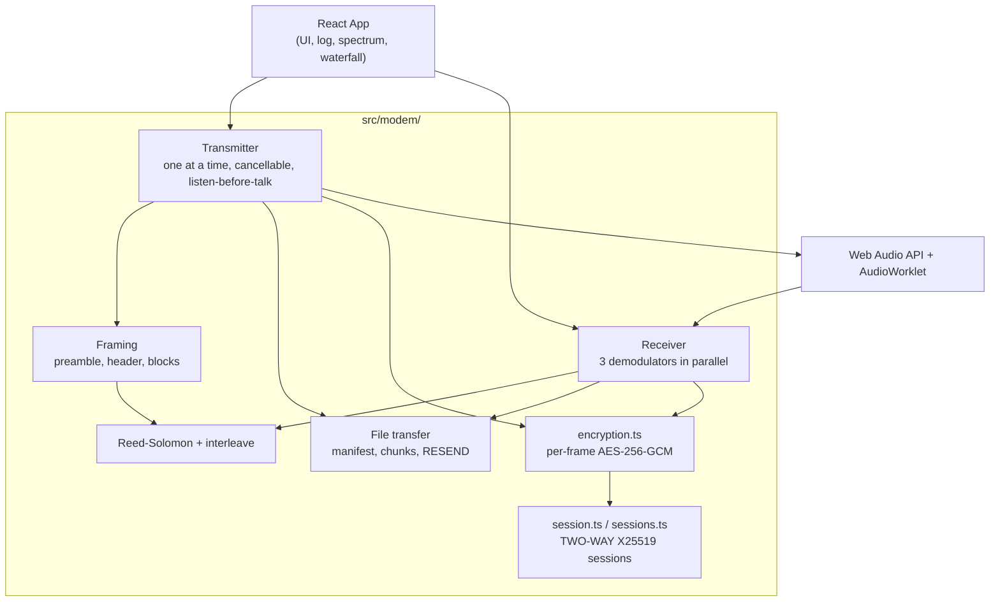
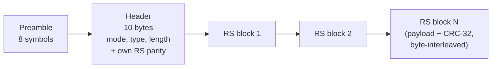
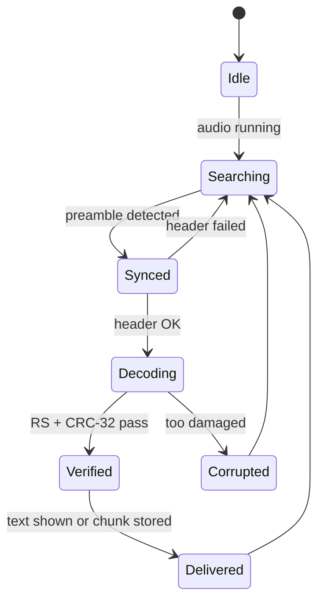
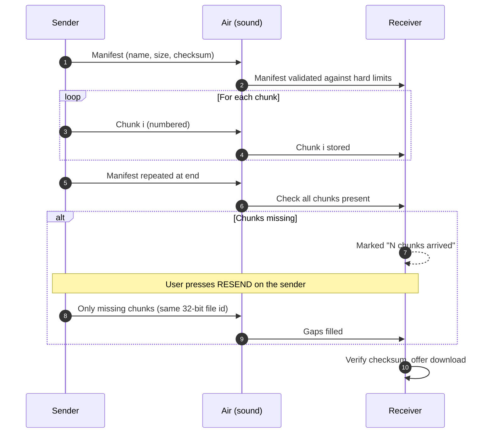
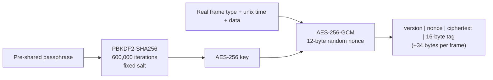
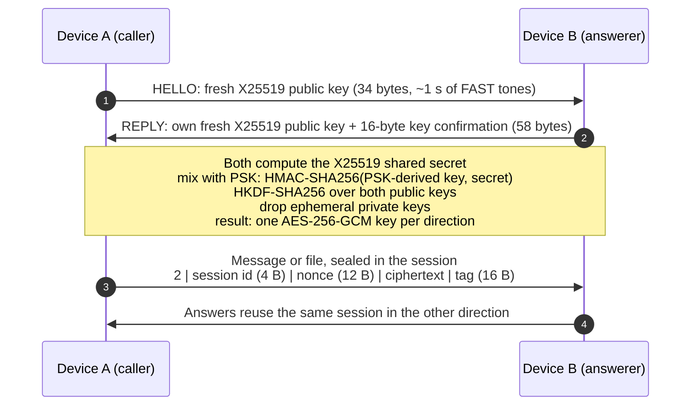
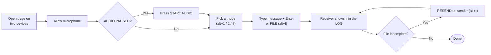
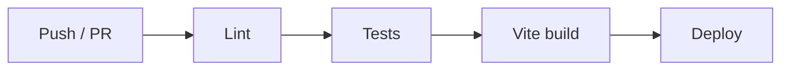

<div align="center">


<br/>

# 🔊 SonicBridge

### Sound-based Data Transfer — offline, air-gapped, no pairing required

*One device plays a burst of tones through its speaker. Another decodes it from its microphone.*
*No network. No internet. No Bluetooth. No pairing. No account.*

<br/>


</div>

---

## 📑 Table of Contents

1. [Overview](#-overview)
2. [Key Features](#-key-features)
3. [Tech Stack](#-tech-stack)
4. [System Design](#-system-design)
5. [Transmission Modes](#-transmission-modes)
6. [How It Works (Deep Dive)](#-how-it-works-deep-dive)
7. [File Transfer Flow](#-file-transfer-flow)
8. [Security & Encryption](#-security--encryption)
9. [TWO-WAY Mode (Diffie–Hellman)](#-two-way-mode-pre-shared-key--diffiehellman)
10. [Getting Started](#-getting-started)
11. [Usage Guide](#-usage-guide)
12. [Development & Testing](#-development--testing)
13. [Tips, Limits & Troubleshooting](#-tips-limits--troubleshooting)
14. [Team](#-team)
15. [Acknowledgements](#-acknowledgements)

---

## 🌐 Overview

**SonicBridge** is an offline, air-gapped **acoustic data transmission** tool. It sends **text and small files** through sound waves using a custom multi-tone FSK modem written in TypeScript and running entirely in the browser.

Because the channel is just air, it works where nothing else does: isolated machines, locked-down networks, devices that can't pair, or any situation where you want to move a small piece of data without touching a network.

> ⚠️ **One-way broadcast by design.** There are no acknowledgements, so a sender cannot know whether anyone received a transmission. The log marks messages as **"sent"** and the startup line reads `ready · one-way send · auto-receive`. The only exception is **ENCRYPTED + TWO-WAY** mode (off by default), which begins each session with a handshake the other device answers.

---

## ✨ Key Features

| Feature | Details |
|---|---|
| 💬 **Text & files** | Any UTF-8 text (lowercase and emoji included) plus small files up to **256 KB** |
| 🎚️ **Four modes** | **FAST** (~320 bit/s), **ROBUST** (~85 bit/s), **INAUDIBLE** (~65 bit/s, 18–19 kHz), **ENCRYPTED** (~270 bit/s) |
| 👂 **Listens to all modes at once** | The receiver does not need to match the sender's mode |
| 🛡️ **Error correction** | Reed–Solomon + byte interleaving + CRC-32; low-confidence bytes retried as erasures |
| ✅ **Verified delivery of content** | A message only counts as received once its checksum passes; heavily damaged frames are reported as *corrupted* |
| 🔐 **Encryption** | AES-256-GCM per frame, PBKDF2-SHA256 (600,000 iterations) from a pre-shared passphrase |
| 🔁 **Forward secrecy (optional)** | TWO-WAY mode adds an ephemeral X25519 key exchange mixed with the pre-shared key |
| 📁 **Resumable files** | Manifest + numbered chunks; **RESEND** fills in only the missing chunks |
| 🛑 **Cancel anytime** | `ESC` cancels a transmission |
| 🧪 **Loopback TEST** | Checks whether a device can hear its own signal in the selected mode |
| 🖥️ **Terminal-style UI** | Live 0–20 kHz spectrum with peak hold, scrolling waterfall, transfer log with progress bars, per-mode link statistics, keyboard shortcuts |

> ⚠️ A transmission the receiver never detects (too quiet, too far, drowned out) **leaves no trace** on the receiver. Only frames that were detected but too damaged are reported as corrupted.

---

## 🧰 Tech Stack

<div align="center">


</div>

| Technology | Logo | Where it's used in SonicBridge |
|---|:---:|---|
| **React** |  | Terminal-style UI: spectrum, waterfall, transfer log, status bar, settings (mode, key, TWO-WAY) |
| **TypeScript** |  | The whole modem (`src/modem/`), framing, Reed–Solomon, encryption and session logic, plus the test suite |
| **Vite** |  | Dev server (`npm run dev`, default `http://localhost:5173`) and production build |
| **Web Audio API** |  | Tone synthesis for the speaker, microphone capture, spectrum analysis |
| **AudioWorklet** |  | Streams **raw microphone samples** to the demodulators; the sample count is the receiver's clock |
| **Web Crypto API** |  | AES-256-GCM, PBKDF2-SHA256, HMAC-SHA256, HKDF-SHA256, X25519 (requires https or localhost) |
| **Node.js 22.18+** |  | Runs the tests directly on TypeScript sources, plus build tooling |
| **npm / Yarn** |  | Dependency management and scripts (`dev`, `test`, `bench`, `lint`) |
| **Git & GitHub** |  | Version control and collaboration |
| **GitHub Actions** |  | Deploy workflow: lint → tests → build |

### Algorithms & Techniques (not libraries)

| Technique | Purpose |
|---|---|
| **Multi-tone FSK** | 16 tones per group, 4 bits per tone, several groups sounding at once |
| **Reed–Solomon (FEC)** | Corrects byte errors; header has its own parity |
| **Byte interleaving** | Spreads burst errors across blocks |
| **CRC-32** | End-to-end integrity check |
| **Raised-cosine ramps** | Avoid clicks between symbols |
| **Early/late clock tracker** | Follows clock drift between devices |
| **Deflate** | Compresses files when it helps |
| **Listen-before-talk** | Avoids talking over another transmission |

---

## 🏗️ System Design

### 1. High-level architecture

```mermaid
flowchart LR
    subgraph SENDER["📤 Sender Device (browser)"]
        direction TB
        S_UI["React UI<br/>text / file / mode / key"]
        S_ENC["Encryption layer<br/>AES-256-GCM (ENCRYPTED mode)"]
        S_FRAME["Framer<br/>preamble + header + payload + CRC-32"]
        S_RS["Reed-Solomon encoder<br/>+ byte interleaver"]
        S_MOD["Multi-tone FSK modulator"]
        S_AUDIO["Web Audio API<br/>speaker output"]
        S_UI --> S_ENC --> S_FRAME --> S_RS --> S_MOD --> S_AUDIO
    end

    AIR(("🌬️ Air<br/>sound waves<br/>noise / echo / people talking"))

    subgraph RECEIVER["📥 Receiver Device (browser)"]
        direction TB
        R_MIC["Microphone"]
        R_WL["AudioWorklet<br/>raw samples"]
        R_DEMOD["Demodulators<br/>FAST / ROBUST / INAUDIBLE"]
        R_SYNC["Preamble search<br/>timing refinement<br/>early/late tracker"]
        R_RS["Deinterleave + Reed-Solomon decode<br/>erasure retries"]
        R_CRC["CRC-32 check"]
        R_DEC["Decryption layer<br/>(if encrypted)"]
        R_UI["React UI<br/>log / progress / download"]
        R_MIC --> R_WL --> R_DEMOD --> R_SYNC --> R_RS --> R_CRC --> R_DEC --> R_UI
    end

    S_AUDIO ==>|"tones"| AIR ==>|"tones"| R_MIC
```



### 2. Module layout (modem core)



### 3. Transmit (TX) pipeline


### 4. Receive (RX) pipeline


### 5. Frame structure



### 6. Receiver state machine



---

## 🎚️ Transmission Modes

| Mode | Tones at a time | Band | Raw rate | Effective rate | 100-byte message | Best for |
|---|:---:|---|---|---|---|---|
| **FAST** | 4 | 1.5–7.9 kHz | 533 bit/s | ~320 bit/s | ~2.5 s | Quiet rooms, devices close together |
| **ROBUST** | 2 | 1.5–4.7 kHz | 133 bit/s | ~85 bit/s | ~9 s | Noisy or echoey rooms |
| **INAUDIBLE** | 1 | 18–19 kHz | 100 bit/s | ~65 bit/s | ~12.5 s | Quiet, discreet transfer |
| **ENCRYPTED** | 4 (as FAST) | as FAST | 533 bit/s | ~270 bit/s | ~3 s | Confidential data (34 bytes overhead per frame) |

**About INAUDIBLE:** it is *near*-ultrasonic, not ultrasonic, and device-dependent. A 44.1/48 kHz sample rate does **not** guarantee that a speaker and microphone actually reproduce 18–19 kHz. Run the loopback **TEST** on each device first.
- Uses one tone at a time, because two simultaneous high tones can produce an audible difference tone through a small speaker.
- Will **not** work over Bluetooth speakers or headsets.
- Some young people (and most pets) can still hear it.

---

## 🔬 How It Works (Deep Dive)

### Framing
Each message becomes a **frame**:
1. **Preamble**: 8 symbols the receiver searches for.
2. **Header**: 10 bytes (mode, type, length), protected by its own Reed–Solomon parity.
3. **Payload + CRC-32**: split into Reed–Solomon blocks, then **byte-interleaved** so burst errors are spread across blocks.

### Modulation: multi-tone FSK
- Every symbol sounds **one tone per group**; each group picks **one of 16 tones**, carrying **4 bits**.
- **Even and odd symbols use two interleaved tone sets**, so room echoes of the previous symbol land on tones the receiver ignores.
- Short **raised-cosine ramps** between symbols avoid clicks.

### Reception
- An **AudioWorklet** streams raw microphone samples to the demodulators.
- Demodulators use the **sample count as their clock**, not timers or screen refreshes. (Whether a browser keeps capturing audio in a background tab varies.)
- They slide a window looking for the preamble, refine timing, then read each symbol at its known position while an **early/late tracker** follows clock drift between devices.
- **Low-confidence bytes are retried as erasures** during error correction.

### Transmitting rules
- One transmission at a time, cancellable.
- **Listen before talk**: waits for any frame currently being received to finish.
- Transfers longer than **15 minutes of airtime are refused**.

> The wire format is pinned by known-answer tests (`test/wireFormat.test.ts`). It is **not compatible** with the earlier character-per-tone version of Chirp, so **both devices need this version**.

---

## 📁 File Transfer Flow

Files are sent as a **manifest frame** (name, size, checksum) followed by **numbered chunk frames**, compressed with deflate when that helps. The manifest is **repeated at the end**, and **RESEND** reuses the 32-bit file id so a receiver can fill in chunks it missed.



### Receiver safety limits

| Limit | Value |
|---|---|
| Maximum file size | **256 KB** |
| Manifest validation | Consistent chunk counts and exact chunk lengths, checked **before** allocating anything |
| Decompression | Capped at the **declared size** |
| Incomplete transfers kept | At most **8** |
| Chunks that arrive before their manifest | No more than the largest valid file per transfer, **1 MB** across all of them |
| Idle transfers | Dropped after **10 minutes** of silence |
| Downloads | Offered as `application/octet-stream`, never opened in the page |

---

## 🔐 Security & Encryption

### Unencrypted modes (FAST, ROBUST, INAUDIBLE)
Nothing is encrypted. The checksum proves the data was **not damaged**, not **who sent it**. Anyone within earshot can transmit or listen. Received text is shown as plain text, and files are only offered as downloads.

### ENCRYPTED mode



| ✅ Protected | ❌ Not hidden |
|---|---|
| Message text | That a transmission happened |
| File contents | When it happened |
| File names and types | Which mode was used |
| Frame type (encrypted) | How long it lasted, and lengths / traffic patterns (a run of similar-sized chunks between two manifests can reveal a file rather than a message) |

**Passphrase = the whole defence.**
- Anyone who records a transmission can guess passphrases **offline**, and the fixed salt means each guess works against **every** recording.
- **GENERATE** fills in a random **25-character key (125 bits)**, which makes guessing hopeless. Read it out to the other device in person.
- A typed key should be **5 or more random, unrelated words**, never a phrase.
- Everyone who knows the key can read every message and send messages that look genuine. There is no sender identity beyond "knows the key".

**Replay protection:** frames stamped more than **50 minutes** ago or more than **30 minutes** ahead (by the receiver's clock) are refused. Within that window, already-opened frames are ignored until the page reloads. A replay of a frame the receiver never heard the first time cannot be recognised.

**No forward secrecy** unless TWO-WAY is on: if the passphrase leaks later, earlier recordings can be decrypted.

**No silent downgrades:** RESEND of a file that was sent encrypted refuses to go out while an unencrypted mode is selected.

**Key handling:**
- Masked unless **SHOW** is pressed, locked while sending, kept **in memory only**, and dropped (with the derived key) when the field is cleared or the tab closes.
- A receiver uses the key for any encrypted frame it hears, whichever send mode is selected. Frames that arrive before the key is entered are **not kept**.
- Changing the key starts afresh: unfinished encrypted transfers are dropped, in-flight frames under the old key are discarded, and RESEND picks a new file id.
- Encryption needs a **secure page** (https or localhost).
- Decrypted file frames are assembled apart from plain ones, so an unencrypted frame can never join, rename or complete an encrypted transfer.
- The loopback TEST is **never encrypted**.

---

## 🤝 TWO-WAY Mode: Pre-shared Key + Diffie–Hellman

A checkbox under the key, **off by default** so ENCRYPTED keeps working one-way (a sender with no microphone, a receiver that never transmits). When on, **both devices** need it on, the **same key**, and a working speaker **and** microphone.



### Session behaviour

| Aspect | Behaviour |
|---|---|
| Frame overhead | Same **34 bytes** as plain ENCRYPTED |
| Turn taking | Each turn waits after the other device's last frame (≥ **0.4 s**; ~**0.7 s** after FAST, ~**1.4 s** after ROBUST / INAUDIBLE) so it never lands between frames of someone else's file |
| Session lifetime | Reused in both directions until **40 minutes** after the handshake; frames open for **1 hour**; then the next send creates a new session |
| Lost hello | Asked again up to **3 times** after a random pause; a lost reply is repeated |
| No answer | Nothing is sent. **Never** a fallback to the plain key |
| Both call at once | The hello with the **lower public key** wins; the other answers it, lets the winner's data go first, then calls again |
| Mic not live | A send needing a handshake is refused immediately, with **RETRY MIC** |
| Lost session | Receiver reports frames as "not in this session"; **NEW SESSION** forces a fresh handshake (old-session frames keep opening for 20 min) |
| Session limits | At most **8 confirmed** and, separately, **8 unconfirmed** sessions per device, so hellos can never evict an established session |
| Replays | Within a session each nonce opens once; each direction has its own key, so a reflected frame does not open; no clocks needed |
| Provenance labels | Received: `decrypted · PSK only` or `decrypted · two-way` (with session code for messages); sent: `PSK only` or `two-way` |

### What TWO-WAY adds vs. what it doesn't

| ✅ Adds | ❌ Does not give you |
|---|---|
| **Forward secrecy**: a full recording stays unreadable even if the passphrase leaks later | Protection if an attacker sends their own hello and gets a reply (they can then guess the passphrase offline against that reply), so the passphrase must still be strong |
| No offline passphrase guessing against a passive recording | Protection against someone who knows the passphrase and sits in the middle of a live handshake (by being louder or jamming one side) |
| Replays need no clocks | Proof of identity: the **session code** (hash of both public keys) is only an identifier; matching codes catch a careless mistake but don't prove who is on the other end |
| | Multi-device sessions: sessions are pairwise, so with more than two devices only the one whose reply arrived first can read the caller |
| | Quantum resistance: X25519 is not quantum-resistant |

The hello is deliberately **unauthenticated**: a tag keyed by the passphrase would let any recording test guesses. Everything visible without TWO-WAY (that you transmitted, when, how long) is still visible with it. Sessions live **in memory only** and end when the key changes, TWO-WAY is turned off, or the page reloads.

---

## 🚀 Getting Started

### Prerequisites
- **Node.js 22.18 or newer** (the build works on older versions, but the tests run the TypeScript sources directly)
- **npm** or **yarn**
- A modern browser with microphone access and a working speaker

### Installation

1. Clone the repository

   With the GitHub CLI:
   ```bash
   gh repo clone <your-username>/sonicbridge
   ```
   Otherwise:
   ```bash
   git clone https://github.com/<your-username>/sonicbridge.git
   cd sonicbridge
   ```

2. Install dependencies
   ```bash
   npm install
   # or
   yarn
   ```

### Running the application

```bash
npm run dev
# or
yarn dev
```

Open the URL shown in the terminal (usually `http://localhost:5173`).

---

## 📖 Usage Guide



1. Open the page on **two devices** and allow microphone access. Browsers keep audio paused until you interact, so press **`[ START AUDIO ]`** in the status bar if it shows `AUDIO PAUSED`.
2. Pick a mode under **TRANSMIT** (or press `alt+1/2/3`). The receiver does not need to match, because it listens for all modes.
3. Type a message and press **Enter** or **`[ SEND ]`**, or use **`[ FILE ]`** / `alt+f` to send a file (up to **256 KB** and **15 minutes** of airtime; transfers over a minute ask for confirmation). **`ESC`** cancels.
4. Received messages and files appear in the **LOG**; click a file name to download it. A file that stops arriving is marked with how many chunks arrived; **`[ RESEND ]`** / `alt+r` on the sender fills in the missing chunks.
5. **`[ TEST ]`** / `alt+t` plays a test frame and checks that the same device decodes it, which tells you whether its speaker and microphone work in that mode.
6. The **status bar** shows whether the microphone is live, with **RETRY MIC / LISTEN / STOP** as needed (RETRY MIC in a log message works too). Without a microphone SonicBridge can still **send**.
7. The **diagnostics** under the spectrum show per-mode sync/frame/error counts and the signal margin of the last frame.
8. **`[ ? EXPLAIN THIS ]`** opens a separate page on how data travels through sound, with playable demos. It replaces the app in the tab, so **nothing can be received there** until you go back.

### Keyboard shortcuts

| Shortcut | Action |
|---|---|
| `Enter` | Send message |
| `ESC` | Cancel transmission |
| `alt+1` / `alt+2` / `alt+3` | Select transmit mode |
| `alt+f` | Send a file |
| `alt+r` | RESEND missing chunks |
| `alt+t` | Loopback TEST |

---

## 🧪 Development & Testing

```bash
npm test        # modem, transmitter, file-transfer and wire-format tests
                # acoustic tests run through a simulated room:
                # noise, echo, clock drift, dropouts, speaker band limits,
                # speech and music interference
npm run bench   # delivery rate and goodput per mode under increasingly hard conditions
npm run lint
```



The deploy workflow runs **lint and tests before building**. The simulator is **not a substitute for real devices**: it does not model actual speaker/microphone frequency responses, distortion, or OS audio processing.

---

## 💡 Tips, Limits & Troubleshooting

| Situation | What to do |
|---|---|
| FAST fails in an echoey room or with people talking | Switch to **ROBUST** |
| Nothing is received | Move devices closer, raise volume (without distortion), run **TEST** |
| INAUDIBLE doesn't work | Many speakers/mics don't reproduce 18–19 kHz; run **TEST** on both devices |
| Bluetooth speaker or headset in use | Turn off Bluetooth audio output |
| Audio stops mid-transfer on mobile | Keep the page in the **foreground**; background tabs or screen lock may suspend audio |
| No sound, `AUDIO PAUSED` | Interact with the page / press **START AUDIO** |
| Microphone blocked | Grant mic permission explicitly in browser settings |
| Encrypted frames "not in this session" | Press **NEW SESSION** on the sender and resend |
| Encrypted frames lost before key entered | Frames heard before the key was set are not kept; sender must resend |
| Encryption unavailable | Use **https** or **localhost** |

---

## 👥 Team

This project is a collaboration between:

| Name | Role |
|---|---|
| **Akshat Srivastava** | Core contributor |
| **Anuj Raj** | Core contributor |
| **Sachin Kumar Jha** | Core contributor |
| **Irfan Khan** | Core contributor |

---

## 🙏 Acknowledgements

SonicBridge builds on the open-source **Chirp** project ([`solst-ice/chirp`](https://github.com/solst-ice/chirp)). Credit to the original author for the modem design and the foundation this work extends.

---

<div align="center">

**Made with 🔊 by Akshat Srivastava, Anuj Raj, Sachin Kumar Jha & Irfan Khan**

</div>
