<div align="center">

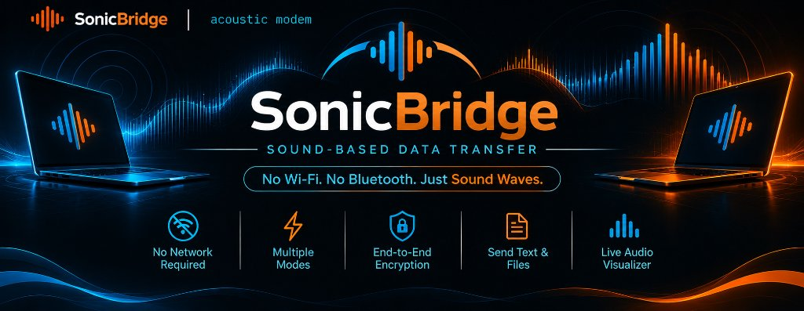

<br/>

# 🔊 SonicBridge

### Sound-based Data Transfer — offline, air-gapped, no pairing required

*One device plays a burst of tones through its speaker. Another decodes it from its microphone.*
*No network. No internet. No Bluetooth. No pairing. No account.*

<br/>

[](https://sonicbridge-mu.vercel.app/)
<br/>
🔗 **Live Website:** [https://sonicbridge-mu.vercel.app/](https://sonicbridge-mu.vercel.app/)

<br/>


</div>

---

## 📑 Table of Contents

1. [Overview](#-overview)
2. [Key Features](#-key-features)
3. [Tech Stack](#-tech-stack)
4. [System Design](#-system-design)
5. [Transmission Modes](#-transmission-modes)
6. [How It Works (Deep Dive)](#-how-it-works-deep-dive)
   - [1 · Sound is a List of Numbers](#sound-physics)
   - [2 · Version 1: The Naive Beginning](#version-1-naive)
   - [3 · Hearing Sound: The FFT](#hearing-fft)
   - [4 · Where Version 1 Broke Down](#version-1-limits)
   - [5 · Version 2: Modern Acoustic Modem](#version-2-modem)
   - [6 · Evolution Benchmark: V1 vs. V2](#evolution-benchmark)
   - [7 · Cryptographic Sealing & 4-Gate Pipeline](#cryptography-pipeline)
   - [8 · TWO-WAY Forward Secrecy (Diffie–Hellman)](#two-way-forward-secrecy)
   - [9 · Golden Rules for Acoustic Transfer](#golden-rules)
7. [File Transfer Flow](#-file-transfer-flow)
8. [Security & Encryption](#-security--encryption)
9. [TWO-WAY Mode (Diffie–Hellman)](#-two-way-mode-pre-shared-key--diffiehellman)
10. [Getting Started](#-getting-started)
11. [Usage Guide](#-usage-guide)
12. [Development & Testing](#-development--testing)
13. [Tips, Limits & Troubleshooting](#-tips-limits--troubleshooting)
14. [Team](#-team)
15. [Acknowledgements](#-acknowledgements)

---

## 🌐 Overview

> 🌐 **Live Demo:** Try it directly in your browser: [**https://sonicbridge-mu.vercel.app/**](https://sonicbridge-mu.vercel.app/)

**SonicBridge** is an offline, air-gapped **acoustic data transmission** tool. It sends **text and small files** through sound waves using a custom multi-tone FSK modem written in TypeScript and running entirely in the browser.

Because the channel is just air, it works where nothing else does: isolated machines, locked-down networks, devices that can't pair, or any situation where you want to move a small piece of data without touching a network.

> ⚠️ **One-way broadcast by design.** There are no acknowledgements, so a sender cannot know whether anyone received a transmission. The log marks messages as **"sent"** and the startup line reads `ready · one-way send · auto-receive`. The only exception is **ENCRYPTED + TWO-WAY** mode (off by default), which begins each session with a handshake the other device answers.

---

## ✨ Key Features

| Feature | Details |
|---|---|
| 💬 **Text & files** | Any UTF-8 text (lowercase and emoji included) plus small files up to **256 KB** |
| 🎚️ **Four modes** | **FAST** (~320 bit/s), **ROBUST** (~85 bit/s), **INAUDIBLE** (~65 bit/s, 18–19 kHz), **ENCRYPTED** (~270 bit/s) |
| 👂 **Listens to all modes at once** | The receiver does not need to match the sender's mode |
| 🛡️ **Error correction** | Reed–Solomon + byte interleaving + CRC-32; low-confidence bytes retried as erasures |
| ✅ **Verified delivery of content** | A message only counts as received once its checksum passes; heavily damaged frames are reported as *corrupted* |
| 🔐 **Encryption** | AES-256-GCM per frame, PBKDF2-SHA256 (600,000 iterations) from a pre-shared passphrase |
| 🔁 **Forward secrecy (optional)** | TWO-WAY mode adds an ephemeral X25519 key exchange mixed with the pre-shared key |
| 📁 **Resumable files** | Manifest + numbered chunks; **RESEND** fills in only the missing chunks |
| 🎮 **Gamer & Squad Identity** | Authenticate via **MongoDB** or **100% Offline Guest** mode; pick squad (🔵 Blue, 🔴 Red, 🟢 Neon, ⚪ Solo) and avatar; transmit identity headers over sound waves |
| 🏆 **Squad Leaderboard & Battle Radar** | Real-time MongoDB aggregation pipeline (`/api/auth/leaderboard`) tracking squad scores, beamed acoustic bytes, and arena MVP with 100% air-gapped tournament cache |
| 🛑 **Cancel anytime** | `ESC` cancels a transmission |
| 🧪 **Loopback TEST** | Checks whether a device can hear its own signal in the selected mode |
| 🖥️ **Terminal-style UI** | Live 0–20 kHz spectrum with peak hold, scrolling waterfall, transfer log with progress bars, per-mode link statistics, keyboard shortcuts |

> ⚠️ A transmission the receiver never detects (too quiet, too far, drowned out) **leaves no trace** on the receiver. Only frames that were detected but too damaged are reported as corrupted.

---

## 🧰 Tech Stack

<div align="center">


</div>

| Technology | Logo | Where it's used in SonicBridge |
|---|:---:|---|
| **React** |  | Terminal-style UI: spectrum, waterfall, transfer log, status bar, settings (mode, key, TWO-WAY) |
| **TypeScript** |  | The whole modem (`src/modem/`), framing, Reed–Solomon, encryption and session logic, plus the test suite |
| **Vite** |  | Dev server (`npm run dev`, default `http://localhost:5173`) and production build |
| **Web Audio API** |  | Tone synthesis for the speaker, microphone capture, spectrum analysis |
| **AudioWorklet** |  | Streams **raw microphone samples** to the demodulators; the sample count is the receiver's clock |
| **Web Crypto API** |  | AES-256-GCM, PBKDF2-SHA256, HMAC-SHA256, HKDF-SHA256, X25519 (requires https or localhost) |
| **Node.js 22.18+** |  | Runs the tests directly on TypeScript sources, plus build tooling |
| **Express.js** |  | Backend REST API (`server/server.js`) for gamer authentication, stats logging, and JWT sessions |
| **MongoDB & Mongoose** |  | Gamer profile database (`server/models/User.js`) with resilient in-memory fallback for air-gapped LAN events |
| **npm / Yarn** |  | Dependency management and scripts (`dev`, `test`, `bench`, `lint`) |
| **Git & GitHub** |  | Version control and collaboration |
| **GitHub Actions** |  | Deploy workflow: lint → tests → build |

### Algorithms & Techniques (not libraries)

| Technique | Purpose |
|---|---|
| **Multi-tone FSK** | 16 tones per group, 4 bits per tone, several groups sounding at once |
| **Reed–Solomon (FEC)** | Corrects byte errors; header has its own parity |
| **Byte interleaving** | Spreads burst errors across blocks |
| **CRC-32** | End-to-end integrity check |
| **Raised-cosine ramps** | Avoid clicks between symbols |
| **Early/late clock tracker** | Follows clock drift between devices |
| **Deflate** | Compresses files when it helps |
| **Listen-before-talk** | Avoids talking over another transmission |

---

## 🏗️ System Design

### 1. High-level architecture

```mermaid
flowchart LR
    subgraph SENDER["📤 Sender Device (browser)"]
        direction TB
        S_UI["React UI<br/>text / file / mode / key"]
        S_ENC["Encryption layer<br/>AES-256-GCM (ENCRYPTED mode)"]
        S_FRAME["Framer<br/>preamble + header + payload + CRC-32"]
        S_RS["Reed-Solomon encoder<br/>+ byte interleaver"]
        S_MOD["Multi-tone FSK modulator"]
        S_AUDIO["Web Audio API<br/>speaker output"]
        S_UI --> S_ENC --> S_FRAME --> S_RS --> S_MOD --> S_AUDIO
    end

    AIR(("🌬️ Air<br/>sound waves<br/>noise / echo / people talking"))

    subgraph RECEIVER["📥 Receiver Device (browser)"]
        direction TB
        R_MIC["Microphone"]
        R_WL["AudioWorklet<br/>raw samples"]
        R_DEMOD["Demodulators<br/>FAST / ROBUST / INAUDIBLE"]
        R_SYNC["Preamble search<br/>timing refinement<br/>early/late tracker"]
        R_RS["Deinterleave + Reed-Solomon decode<br/>erasure retries"]
        R_CRC["CRC-32 check"]
        R_DEC["Decryption layer<br/>(if encrypted)"]
        R_UI["React UI<br/>log / progress / download"]
        R_MIC --> R_WL --> R_DEMOD --> R_SYNC --> R_RS --> R_CRC --> R_DEC --> R_UI
    end

    S_AUDIO ==>|"tones"| AIR ==>|"tones"| R_MIC
```

### 2. Module layout (modem core)

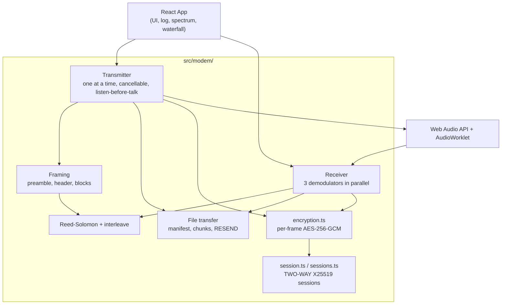

### 3. Transmit (TX) pipeline

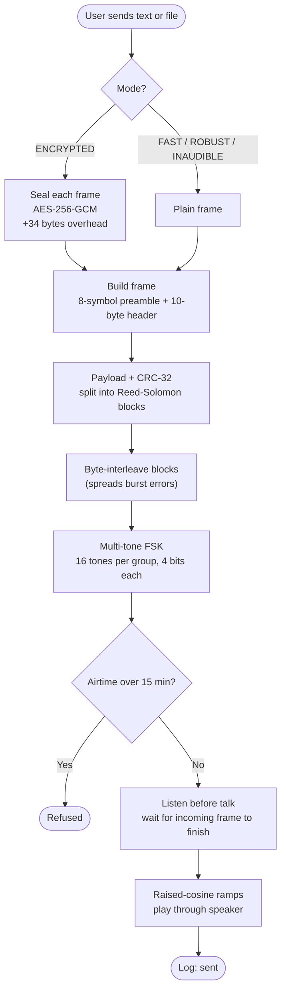

### 4. Receive (RX) pipeline

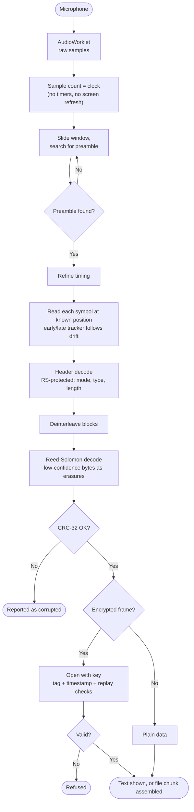

### 5. Frame structure

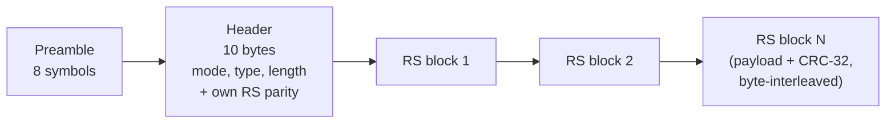

### 6. Receiver state machine

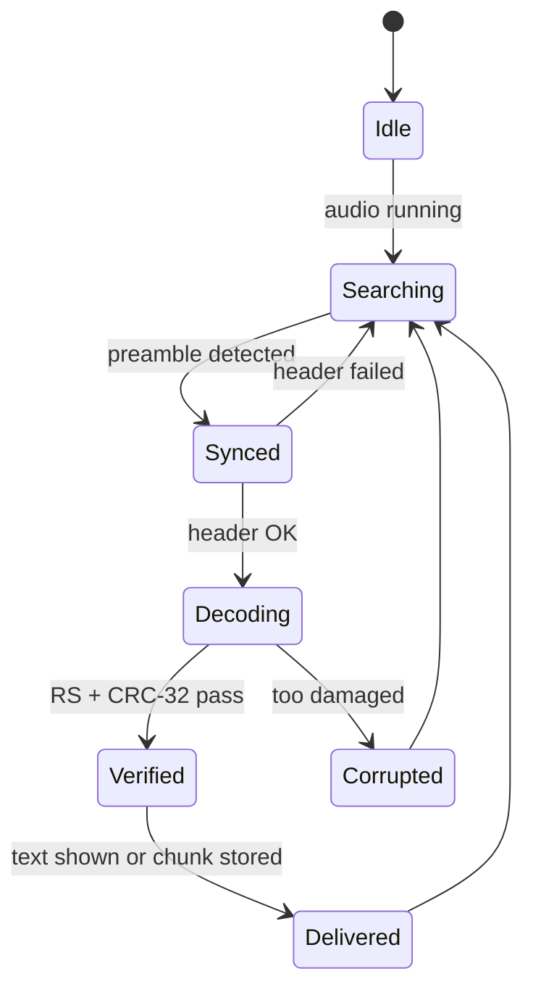

---

## 🎚️ Transmission Modes

| Mode | Tones at a time | Band | Raw rate | Effective rate | 100-byte message | Best for |
|---|:---:|---|---|---|---|---|
| **FAST** | 4 | 1.5–7.9 kHz | 533 bit/s | ~320 bit/s | ~2.5 s | Quiet rooms, devices close together |
| **ROBUST** | 2 | 1.5–4.7 kHz | 133 bit/s | ~85 bit/s | ~9 s | Noisy or echoey rooms |
| **INAUDIBLE** | 1 | 18–19 kHz | 100 bit/s | ~65 bit/s | ~12.5 s | Quiet, discreet transfer |
| **ENCRYPTED** | 4 (as FAST) | as FAST | 533 bit/s | ~270 bit/s | ~3 s | Confidential data (34 bytes overhead per frame) |

**About INAUDIBLE:** it is *near*-ultrasonic, not ultrasonic, and device-dependent. A 44.1/48 kHz sample rate does **not** guarantee that a speaker and microphone actually reproduce 18–19 kHz. Run the loopback **TEST** on each device first.
- Uses one tone at a time, because two simultaneous high tones can produce an audible difference tone through a small speaker.
- Will **not** work over Bluetooth speakers or headsets.
- Some young people (and most pets) can still hear it.

---

## 🔬 How It Works (Deep Dive)

> ### 📡 The Core Pipeline
> **Two devices, a speaker and a microphone, no network.** Starting from physical air vibrations to cryptographic forward secrecy:
>
> $$\text{Text / File} \longrightarrow \text{Bytes} \longrightarrow \text{Nibbles} \longrightarrow \text{Tones} \xrightarrow{\text{Air Waves}} \text{Microphone Samples} \longrightarrow \text{FFT} \longrightarrow \text{Reed-Solomon Recovery} \longrightarrow \text{Bytes} \longrightarrow \text{Text / File}$$

---

<a id="sound-physics"></a>
### 1 · Sound is a List of Numbers (The Physics)
At a physical level, a speaker transmits information by pushing air back and forth, generating pressure waves. A microphone captures those waves by measuring air pressure thousands of times every second.

* **Sampling Rate (48,000 Hz):** In standard Web Audio, the microphone measures air pressure **48,000 times a second** (each sample is a floating-point measurement between `-1.0` and `+1.0`).
* **Pure Tone:** The simplest sound is a pure sinusoidal wave repeating at one constant **frequency**, counted in **Hertz (Hz)** (cycles per second).
  * A lower frequency (e.g., **1,500 Hz**) produces a deeper pitch (the wave oscillates slower).
  * A higher frequency (e.g., **7,000 Hz**) produces a shrill, high pitch (the wave squeezes closely together).

```text
Low Pitch (1,500 Hz):   ──/\────/\────/\────/\────/\────/\────  (longer wavelength)
High Pitch (7,000 Hz):  ─/\/\/\/\/\/\/\/\/\/\/\/\/\/\/\/\/\/\─  (compressed wavelength)
```

---

<a id="version-1-naive"></a>
### 2 · Version 1: The Naive Beginning (One Pitch per Character)
The original, naive approach to acoustic transmission assigned a single dedicated frequency to each character:
* `'A'` was mapped to **5,700 Hz**, `'B'` to **5,800 Hz**, and so on, spaced **100 Hz** apart.
* A message was structured as: `[Start Tone]` $\rightarrow$ `[One short tone per character]` $\rightarrow$ `[End Tone]`.
* Each character was sounded for **70 ms**, followed by **30 ms of quiet silence**.

#### 💥 The "Lost L" Problem
To prevent a single long tone from being counted multiple times, the Version 1 receiver enforced a **120 ms lockout window**: any repeated tone heard within 120 ms was disregarded.
* **The consequence:** In words with duplicate consecutive letters like `"HELLO"`, the second `'L'` arrived within that 120 ms window and was completely dropped. `"HELLO"` became `"HELO"`.

---

<a id="hearing-fft"></a>
### 3 · Hearing Sound: The Fast Fourier Transform (FFT)
A microphone does not receive "pitches"—it only receives a continuous stream of raw pressure numbers.

* **The FFT Prism:** A **Fast Fourier Transform (FFT)** takes a short slice of time-domain samples (e.g., **2,048 samples**, or about **43 ms** at 48 kHz) and measures how much of every frequency it contains—acting like an **optical glass prism splitting white light into a rainbow of colors**.
* In Version 1, the receiver simply identified the loudest frequency spike in the FFT and looked up the nearest character.

#### 💥 The Noise Floor & Silent Corruption
When room noise or background hiss increases (e.g., ambient hiss 9 dB louder than the tone):
* The FFT can still detect a tone quieter than the noise around it.
* However, past a certain noise threshold, a random background spike registers louder than the real tone.
* In Version 1, a completely wrong character was emitted—with **zero checksum, zero warning, and no indication that corruption had occurred**.

---

<a id="version-1-limits"></a>
### 4 · Where Version 1 Broke Down (The 6 Fatal Flaws)

| Flaw | Root Cause | Real-World Impact |
|---|---|---|
| **1. Severely Limited Character Set** | Only 100 Hz bins for ASCII uppercase & digits | No lowercase (`a-z`), no Unicode / emojis (`✓`, `🔥`), and no binary files |
| **2. Vanishing Duplicate Characters** | 120 ms de-duplication lockout window | Repeated letters (e.g., `"HELLO"`, `"BOOK"`, `"1100"`) silently vanished |
| **3. Room Echoes & Reverberation** | Acoustic reflections off walls, desks, monitors | Each tone kept ringing and contaminated the time window of the next tone |
| **4. Browser UI Throttling** | Checked tones on `requestAnimationFrame` | Minimizing the browser or switching tabs throttled timers, freezing reception |
| **5. Undetected Corruption** | Zero forward error correction or checksums | Noise spikes produced false characters indistinguishable from real data |
| **6. Painfully Slow Throughput** | 1 character per 100 ms time slot | Max ~10 characters/sec (a simple 100-character note took >10 seconds) |

---

<a id="version-2-modem"></a>
### 5 · Version 2: Engineering Solutions One Fix at a Time
Today's SonicBridge modem completely replaces the naive character-tone system with a modern **Multi-Tone Frequency-Shift Keying (M-FSK)** acoustic modem, resolving every single flaw.

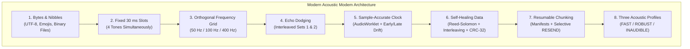

#### 5.1 Bytes Instead of Characters (Universal UTF-8 & Nibbles)
Everything stored on a computer is bytes. Instead of encoding characters directly, SonicBridge encodes **raw binary bytes**:
* Every byte consists of **8 bits**, split into two 4-bit halves called **nibbles** (High Nibble & Low Nibble).
* A 4-bit nibble has $2^4 = 16$ possible values (`0000` to `1111`, or `0x0` to `0xF`).
* Therefore, each nibble only requires choosing **one out of 16 distinct pitch levels**.

> **Example: How `"Hi ✓"` is converted into nibbles:**
> * `'H'` = Hex `0x48` $\rightarrow$ Binary `0100 1000` $\rightarrow$ Nibble 1: **4** (`0100`) \| Nibble 2: **8** (`1000`)
> * `'i'` = Hex `0x69` $\rightarrow$ Binary `0110 1001` $\rightarrow$ Nibble 1: **6** (`0110`) \| Nibble 2: **9** (`1001`)
> * `' '` = Hex `0x20` $\rightarrow$ Binary `0010 0000` $\rightarrow$ Nibble 1: **2** (`0010`) \| Nibble 2: **0** (`0000`)
> * `'✓'` = UTF-8 `0xe2 0x9c 0x93` (3 bytes) $\rightarrow$ 6 nibbles: `[14, 2, 9, 12, 9, 3]`
>
> *Result:* Universal support for any language, emojis, binary payloads, and encrypted frames.

---

#### 5.2 Fixed Time Slots & Four Simultaneous Tones
* **Precise 30 ms Slots (FAST Mode):** Time is sliced into fixed 30 ms slots. The receiver measures the stable center **20 ms**, while **5 ms raised-cosine fade ramps** at each boundary prevent harsh acoustic clicks that would splatter noise across the spectrum.
* **No Lost Doubles:** Two consecutive identical values simply occupy two distinct, consecutive time slots. There is no de-duplication timer, so double characters survive cleanly.
* **4 Tones at Once (Multi-Tone FSK):** Instead of playing one tone at a time, each slot plays **4 tones concurrently**, carrying **4 nibbles = 2 complete bytes per slot**.

```text
Slot Time (30 ms):   |--5ms Fade-In--|------20ms Measurement Window------|--5ms Fade-Out--|
Tone 1 (Carries):    [Byte 1, High Nibble]  ─────────────────────────────► One of 16 pitches
Tone 2 (Carries):    [Byte 1, Low Nibble ]  ─────────────────────────────► One of 16 pitches
Tone 3 (Carries):    [Byte 2, High Nibble]  ─────────────────────────────► One of 16 pitches
Tone 4 (Carries):    [Byte 2, Low Nibble ]  ─────────────────────────────► One of 16 pitches
Total Throughput:    2 Full Bytes (16 Bits) transmitted every 30 milliseconds!
```

---

#### 5.3 The Frequency Grid: Which Pitch Means Which Bits
To prevent the 4 concurrent tones from interfering with each other, each tone has its own dedicated 16-pitch sub-band. The tones **never share a pitch**:

| Tone Channel | Source Data | Bit Pattern | Value | FAST Frequency | Frequency Band |
|:---:|---|:---:|:---:|:---:|:---:|
| **Tone 1** | Byte 1, High Nibble | `0100` | 4 | **3,150 Hz** | 1,500 – 7,500 Hz (Group 1) |
| **Tone 2** | Byte 1, Low Nibble | `1000` | 8 | **4,850 Hz** | 1,600 – 7,600 Hz (Group 2) |
| **Tone 3** | Byte 2, High Nibble | `0110` | 6 | **4,150 Hz** | 1,700 – 7,700 Hz (Group 3) |
| **Tone 4** | Byte 2, Low Nibble | `1001` | 9 | **5,450 Hz** | 1,800 – 7,850 Hz (Group 4) |

> [!NOTE]
> **Why these exact frequencies?**
> 1. **50 Hz Grid (Orthogonality):** Over the 20 ms measurement window, a frequency step of 50 Hz fits exactly one additional sinusoidal cycle ($\Delta f = 1/T = 1/0.02\text{ s} = 50\text{ Hz}$). This ensures adjacent frequency bins have zero mathematical cross-leakage.
> 2. **100 Hz within a slot:** Slots use interleaved tone sets (Set 1 and Set 2), alternating by 100 Hz increments between channels.
> 3. **400 Hz between nibble values:** Within each tone channel, adjacent values (`0000` vs `0001`) are spaced 400 Hz apart, providing massive noise margin and high detection certainty.

---

#### 5.4 Dodging Room Echoes: Alternating Tone Sets
When sound plays in an enclosed room, acoustic waves bounce off walls, windows, and monitors, continuing to reverberate for 20 to 100 ms. If Slot 2 used the same frequencies as Slot 1, the lingering echo would drown out the new signal.

* **The Interleaving Trick:** SonicBridge alternates every slot between **Tone Set 1** and **Tone Set 2**, interleaved **50 Hz apart**.
* **Result:** While Slot 2 is playing on Set 2, the receiver *only reads Set 2 frequencies*. Any lingering echo from Slot 1 is ringing on Set 1 frequencies, which the receiver completely ignores!

```text
Slot 1 (Set 1):  [==== Tone Set 1 ====]  (echoes bounce into the room...)
                                        \
Slot 2 (Set 2):                         [==== Tone Set 2 ====] (Receiver listens ONLY to Set 2!)
                                                                (Set 1 echoes are ignored!)
```

---

#### 5.5 Finding the Start & Keeping Time (Sync & Drift Tracking)
* **8-Slot Preamble Sync:** Every message begins with 8 slots of a mathematically optimized synchronization pattern. The receiver continuously slides this pattern across incoming audio samples, computing cross-correlation. When the correlation matches the known pattern, the demodulator locks on.
* **Clocked by Audio Samples (AudioWorklet):** SonicBridge does not rely on browser JavaScript timers (`setTimeout`, `requestAnimationFrame`), which are heavily throttled or frozen when a tab is in the background. Instead, timing is governed strictly by the **hardware audio sample count** delivered by an `AudioWorklet`. Exactly 1,440 samples (at 48 kHz) equals one 30 ms slot.
* **Early/Late Drift Tracking:** Physical device crystals drift slightly (one phone's clock may tick at 48,005 Hz while the receiver's ticks at 47,994 Hz). The receiver samples each slot slightly early and slightly late, dynamically nudging its internal clock forward or backward to track timing drift over long transmissions.

---

#### 5.6 Self-Healing Data: Reed–Solomon FEC + Byte Interleaving + CRC-32
Even with echo dodging, real-world sound encounters bursts of ambient interference: coughs, key clicks, table bumps, or background speech.

1. **Reed–Solomon Error Correction:** In FAST mode, **16 repair parity bytes** are added to each block of up to 96 data bytes. This can reconstruct up to **8 completely corrupted, missing, or destroyed bytes** per block with 100% mathematical precision.
2. **2D Byte Interleaving:** A physical noise burst (like a cough or dropped pen) typically lasts 50–150 ms, wiping out several consecutive bytes.
   * *Without interleaving:* All 5-10 corrupted bytes would land in a single Reed-Solomon block, overwhelming its 8-byte repair limit and causing total failure.
   * *With interleaving:* Consecutive payload bytes are distributed across multiple blocks (Block 1 Byte 1, Block 2 Byte 1, Block 3 Byte 1...). When a noise burst hits, it corrupts only 1 byte per block—effortlessly recovered by the Reed-Solomon engine.
3. **Low-Confidence Erasures:** During demodulation, bytes with marginal signal-to-noise ratio are tagged as erasures. Reed-Solomon can fix twice as many erasures (up to 16) as unknown errors (8).
4. **CRC-32 Checksum:** After Reed-Solomon reconstruction, a 32-bit CRC verifies that the reconstructed data matches the original byte-for-byte. If any error escaped correction, the frame is safely marked **corrupted** rather than delivering bad data.

```text
Without Interleaving (Noise burst wipes Block 1):
[ B1-D1 | B1-D2 | B1-D3 | B1-D4 | B1-D5 ] ───► [ COUGH BURST ] ───► Block 1 Destroyed (>8 errors)!

With 2D Byte Interleaving (Noise burst spread thin):
[ B1-D1 | B2-D1 | B3-D1 | B1-D2 | B2-D2 ] ───► [ COUGH BURST ] ───► Only 1-2 errors per block (Easily fixed by RS)!
```

---

#### 5.7 Resumable Chunked File Transfers
* Files are compressed with **Deflate** (if compression reduces size).
* The file is divided into numbered chunks and preceded by a **Manifest Frame** (file name, MIME type, total size, hash).
* Chunks can arrive in any order. The manifest is re-sent at the end of transmission.
* If 1 or 2 chunks are lost to interference, pressing **RESEND** re-transmits only the missing chunks, which the receiver slots into its buffer before final assembly.

---

#### 5.8 Three Optimized Acoustic Modes

| Mode | Bandwidth | Simultaneous Tones | Slot Length | Effective Speed | Ideal Scenario |
|:---:|:---:|:---:|:---:|:---:|---|
| **FAST** | 1,500 – 7,850 Hz | 4 tones | 30 ms | ~320 bit/s (100 B in ~2.5 s) | Clean environments, short distances, maximum transfer speed |
| **ROBUST** | 1,500 – 4,650 Hz | 2 tones | 60 ms | ~85 bit/s (100 B in ~9.3 s) | Noisy rooms, echoey halls, people speaking in background |
| **INAUDIBLE** | 18,000 – 19,033 Hz | 1 tone | 40 ms | ~65 bit/s (100 B in ~12.4 s) | Discreet transmission above adult human hearing |

> [!WARNING]
> **Why INAUDIBLE uses strictly ONE tone at a time:**
> When two high-frequency tones above 18 kHz are played simultaneously through small mobile speakers, hardware non-linearities produce **Intermodulation Distortion (IMD)**: a difference tone ($f_2 - f_1$) that is loud and annoying in the human audible band. Limiting INAUDIBLE to 1 tone prevents this buzz entirely.

---

<a id="evolution-benchmark"></a>
### 6 · Evolution Benchmark: Version 1 vs. Version 2

| Metric | Version 1 (Naive Chirp) | Version 2 (SonicBridge FAST) | Improvement |
|---|---|---|:---:|
| **Payload Support** | A–Z, 0–9, basic symbols only | **Any byte stream:** UTF-8 text, emojis (`🎉`), binary files | **Universal** |
| **"HELLO" Airtime** | 0.83 s | **0.82 s** | Similar for tiny inputs (pays sync/parity overhead) |
| **100 ASCII Characters** | 10.3 s | **2.5 s** | **4× Faster** |
| **Error Handling** | Undetected corruption | **100% repaired** via Reed-Solomon, or flagged as corrupted | **Self-healing & verified** |
| **Echo Resistance** | Vulnerable to reverberation | **Interleaved tone sets** dodge reflections | **Immune to short echoes** |
| **Multitasking / Tabs** | Freezes in background tabs | **AudioWorklet clock** immune to tab throttling | **Reliable in background** |

---

<a id="cryptography-pipeline"></a>
### 7 · The Cryptography Layer: AES-256-GCM + PBKDF2
Sound is an open broadcast: anyone within earshot can hear every transmission. Encryption in SonicBridge sits **on top of the acoustic modem**, transforming sensitive payloads into cryptographically opaque bytes before they ever reach the tone generator.

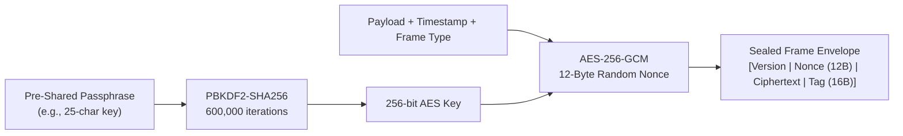

1. **Passphrase to AES Key (PBKDF2-SHA256):** Both devices enter the same passphrase. PBKDF2 executes **600,000 rounds of SHA-256 hashing** to derive a 256-bit AES key. The key itself is never transmitted. The massive iteration count ensures that anyone recording the audio cannot brute-force the passphrase offline.
2. **Sealing Each Frame (AES-256-GCM):**
   * **12-Byte Random Nonce:** Generated afresh for every single frame, ensuring that sending the exact same message twice generates completely different audio tones.
   * **Ciphertext:** Authenticated encryption of payload data and metadata.
   * **16-Byte GCM Authentication Tag:** Guarantees that any modified bit, corrupted frequency, or incorrect key immediately causes decryption to fail.
   * **Overhead:** Only +34 extra bytes per frame (~0.5 s in FAST mode).

#### 🛡️ The 4-Gate Receiver Verification Pipeline
When an encrypted frame arrives, the receiver executes four mandatory security checks in strict sequence:

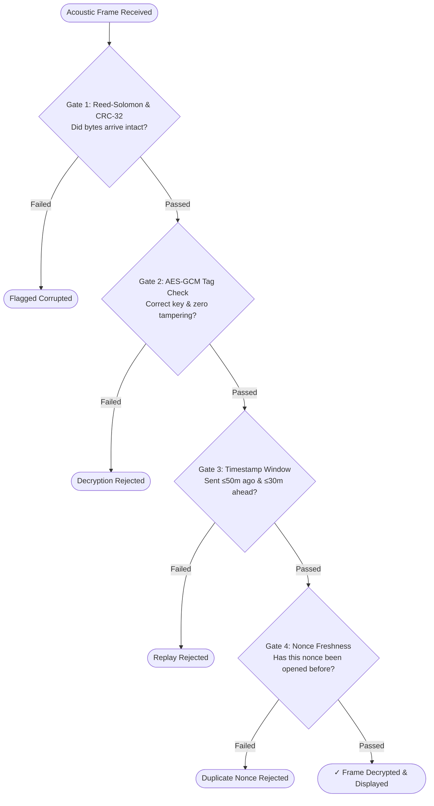

---

<a id="two-way-forward-secrecy"></a>
### 8 · TWO-WAY Forward Secrecy: Ephemeral Diffie–Hellman (X25519)

#### The Recording Dilemma
With passphrase-only encryption, an adversary could record room audio today. If the passphrase is leaked, stolen, or compromised years later, the adversary can retroactively decrypt all recorded audio.

#### The Solution: Forward Secrecy
**TWO-WAY mode** creates an ephemeral (single-session) shared secret using an elliptic-curve **Diffie–Hellman (X25519)** exchange over sound waves. Even if the passphrase is leaked later, historical recordings can **never** be unlocked.

#### 🎨 The "Mixing Paint" Analogy
To understand Diffie–Hellman intuitively:
1. Device A and Device B publicly agree on a starting common color: **Yellow**.
2. Device A picks a secret color: **Red** (its private key). Device B picks a secret color: **Blue** (its private key).
3. Device A mixes Yellow + Red = **Orange** and broadcasts it over the air (public key).
4. Device B mixes Yellow + Blue = **Green** and broadcasts it over the air (public key).
5. Device A adds its secret **Red** to B's **Green** $\rightarrow$ produces **Brown** (the shared secret).
6. Device B adds its secret **Blue** to A's **Orange** $\rightarrow$ produces the exact same **Brown**!
7. **The Eavesdropper:** An adversary heard the public common color (Yellow), Orange, and Green, but separating mixed paint into the original secret colors is mathematically impossible. They can never recreate the secret Brown mixture.

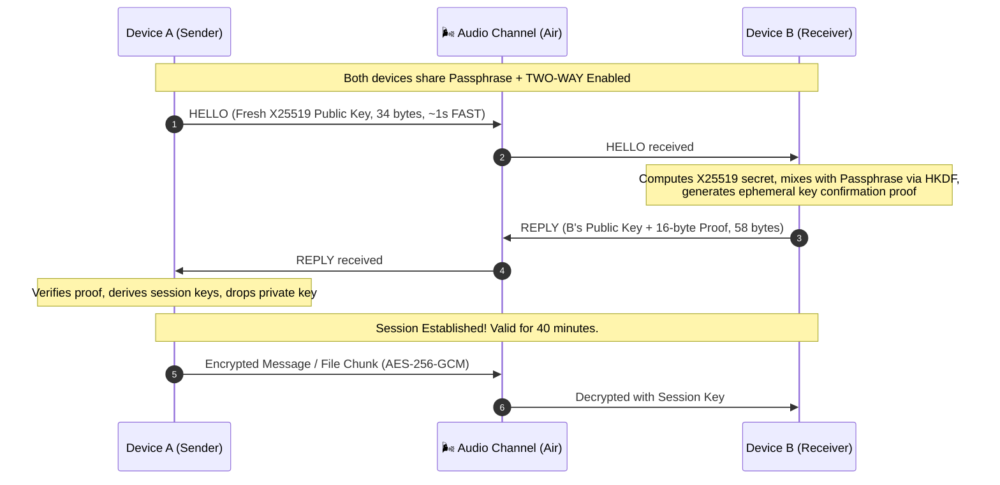

---

<a id="golden-rules"></a>
### 9 · Golden Rules for Reliable Acoustic Data Transfer
To achieve maximum reliability when sending data over sound:

1. ⚡ **Start with FAST mode:** If an unencrypted transmission suffers corruption or fails to detect, switch to **ROBUST** mode (longer slots, greater resilience to reflections and room noise).
2. 📱 **Keep the app in the foreground with screen awake:** Modern mobile operating systems (iOS and Android) aggressively suspend microphone streams and throttle CPU when a browser tab is in the background or the device screen locks.
3. 👂 **Understand delivery confirmation:** "Sent" means the audio finished playing through the speaker, not that another device heard it. Verify receipt on the receiving device's log.
4. 🔊 **Run the loopback TEST for INAUDIBLE mode:** Many smartphone speakers and microphones sharply filter out frequencies above 17 kHz, and Bluetooth audio devices compress/cut off ultrasound entirely. Run loopback **TEST** on both devices before transmitting.
5. 🐾 **Be mindful of high frequencies:** Near-ultrasound (18–19 kHz) is inaudible to most adults, but children, teenagers, and pets (cats and dogs) can hear it clearly and may experience discomfort.
6. 🔐 **For true privacy:** Use **ENCRYPTED** mode with **GENERATE** (producing a random 25-character key) and share the key in person. Enable **TWO-WAY** mode to protect past transmissions against future key disclosure.

> [!IMPORTANT]
> **Wire Format Compatibility:** The wire format is pinned by known-answer tests (`test/wireFormat.test.ts`). Because Version 2 uses Multi-Tone FSK with nibble encoding and Reed–Solomon framing, it is **not backward-compatible** with the earlier naive character-per-tone Version 1. Both communicating devices must run this modem.

---

## 📁 File Transfer Flow

Files are sent as a **manifest frame** (name, size, checksum) followed by **numbered chunk frames**, compressed with deflate when that helps. The manifest is **repeated at the end**, and **RESEND** reuses the 32-bit file id so a receiver can fill in chunks it missed.

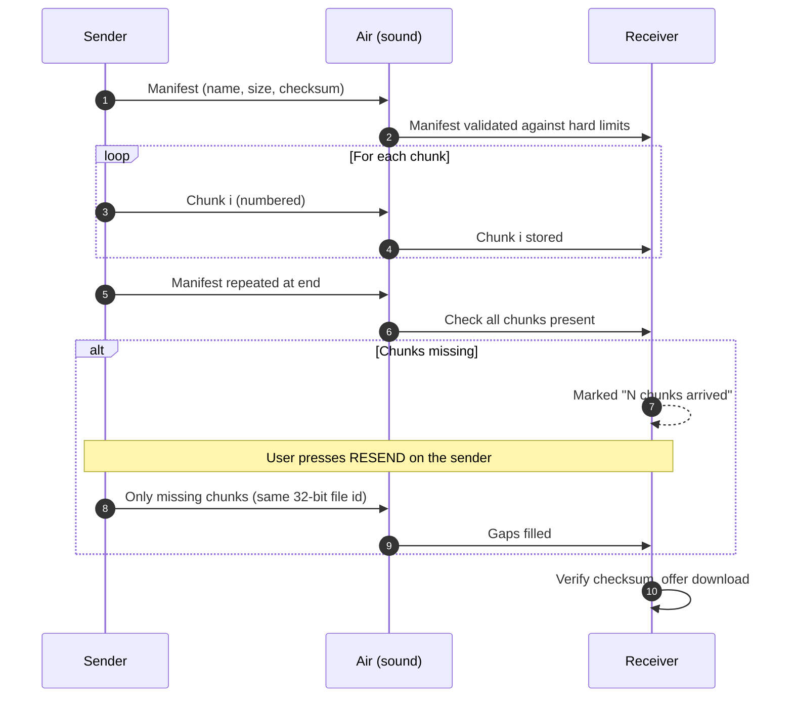

### Receiver safety limits

| Limit | Value |
|---|---|
| Maximum file size | **256 KB** |
| Manifest validation | Consistent chunk counts and exact chunk lengths, checked **before** allocating anything |
| Decompression | Capped at the **declared size** |
| Incomplete transfers kept | At most **8** |
| Chunks that arrive before their manifest | No more than the largest valid file per transfer, **1 MB** across all of them |
| Idle transfers | Dropped after **10 minutes** of silence |
| Downloads | Offered as `application/octet-stream`, never opened in the page |

---

## 🔐 Security & Encryption

### Unencrypted modes (FAST, ROBUST, INAUDIBLE)
Nothing is encrypted. The checksum proves the data was **not damaged**, not **who sent it**. Anyone within earshot can transmit or listen. Received text is shown as plain text, and files are only offered as downloads.

### ENCRYPTED mode

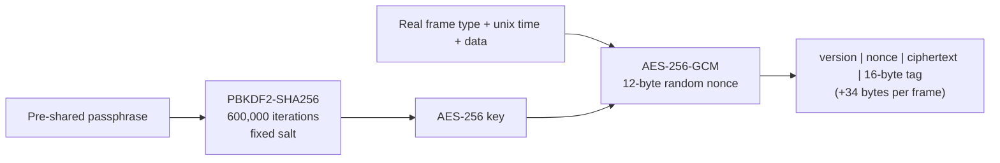

| ✅ Protected | ❌ Not hidden |
|---|---|
| Message text | That a transmission happened |
| File contents | When it happened |
| File names and types | Which mode was used |
| Frame type (encrypted) | How long it lasted, and lengths / traffic patterns (a run of similar-sized chunks between two manifests can reveal a file rather than a message) |

**Passphrase = the whole defence.**
- Anyone who records a transmission can guess passphrases **offline**, and the fixed salt means each guess works against **every** recording.
- **GENERATE** fills in a random **25-character key (125 bits)**, which makes guessing hopeless. Read it out to the other device in person.
- A typed key should be **5 or more random, unrelated words**, never a phrase.
- Everyone who knows the key can read every message and send messages that look genuine. There is no sender identity beyond "knows the key".

**Replay protection:** frames stamped more than **50 minutes** ago or more than **30 minutes** ahead (by the receiver's clock) are refused. Within that window, already-opened frames are ignored until the page reloads. A replay of a frame the receiver never heard the first time cannot be recognised.

**No forward secrecy** unless TWO-WAY is on: if the passphrase leaks later, earlier recordings can be decrypted.

**No silent downgrades:** RESEND of a file that was sent encrypted refuses to go out while an unencrypted mode is selected.

**Key handling:**
- Masked unless **SHOW** is pressed, locked while sending, kept **in memory only**, and dropped (with the derived key) when the field is cleared or the tab closes.
- A receiver uses the key for any encrypted frame it hears, whichever send mode is selected. Frames that arrive before the key is entered are **not kept**.
- Changing the key starts afresh: unfinished encrypted transfers are dropped, in-flight frames under the old key are discarded, and RESEND picks a new file id.
- Encryption needs a **secure page** (https or localhost).
- Decrypted file frames are assembled apart from plain ones, so an unencrypted frame can never join, rename or complete an encrypted transfer.
- The loopback TEST is **never encrypted**.

---

## 🤝 TWO-WAY Mode: Pre-shared Key + Diffie–Hellman

A checkbox under the key, **off by default** so ENCRYPTED keeps working one-way (a sender with no microphone, a receiver that never transmits). When on, **both devices** need it on, the **same key**, and a working speaker **and** microphone.

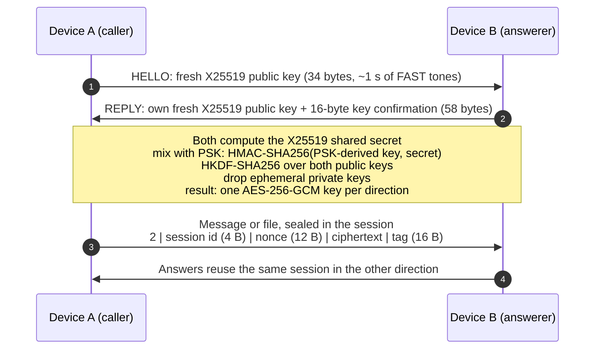

### Session behaviour

| Aspect | Behaviour |
|---|---|
| Frame overhead | Same **34 bytes** as plain ENCRYPTED |
| Turn taking | Each turn waits after the other device's last frame (≥ **0.4 s**; ~**0.7 s** after FAST, ~**1.4 s** after ROBUST / INAUDIBLE) so it never lands between frames of someone else's file |
| Session lifetime | Reused in both directions until **40 minutes** after the handshake; frames open for **1 hour**; then the next send creates a new session |
| Lost hello | Asked again up to **3 times** after a random pause; a lost reply is repeated |
| No answer | Nothing is sent. **Never** a fallback to the plain key |
| Both call at once | The hello with the **lower public key** wins; the other answers it, lets the winner's data go first, then calls again |
| Mic not live | A send needing a handshake is refused immediately, with **RETRY MIC** |
| Lost session | Receiver reports frames as "not in this session"; **NEW SESSION** forces a fresh handshake (old-session frames keep opening for 20 min) |
| Session limits | At most **8 confirmed** and, separately, **8 unconfirmed** sessions per device, so hellos can never evict an established session |
| Replays | Within a session each nonce opens once; each direction has its own key, so a reflected frame does not open; no clocks needed |
| Provenance labels | Received: `decrypted · PSK only` or `decrypted · two-way` (with session code for messages); sent: `PSK only` or `two-way` |

### What TWO-WAY adds vs. what it doesn't

| ✅ Adds | ❌ Does not give you |
|---|---|
| **Forward secrecy**: a full recording stays unreadable even if the passphrase leaks later | Protection if an attacker sends their own hello and gets a reply (they can then guess the passphrase offline against that reply), so the passphrase must still be strong |
| No offline passphrase guessing against a passive recording | Protection against someone who knows the passphrase and sits in the middle of a live handshake (by being louder or jamming one side) |
| Replays need no clocks | Proof of identity: the **session code** (hash of both public keys) is only an identifier; matching codes catch a careless mistake but don't prove who is on the other end |
| | Multi-device sessions: sessions are pairwise, so with more than two devices only the one whose reply arrived first can read the caller |
| | Quantum resistance: X25519 is not quantum-resistant |

The hello is deliberately **unauthenticated**: a tag keyed by the passphrase would let any recording test guesses. Everything visible without TWO-WAY (that you transmitted, when, how long) is still visible with it. Sessions live **in memory only** and end when the key changes, TWO-WAY is turned off, or the page reloads.

---

## 🚀 Getting Started

> ⚡ **Quick Start (No Installation Needed):**  
> You can try SonicBridge immediately in your browser on any phone or laptop:  
> 👉 **[https://sonicbridge-mu.vercel.app/](https://sonicbridge-mu.vercel.app/)**

### Prerequisites
- **Node.js 22.18 or newer** (the build works on older versions, but the tests run the TypeScript sources directly)
- **npm** or **yarn**
- A modern browser with microphone access and a working speaker

### Installation

1. Clone the repository

   With the GitHub CLI:
   ```bash
   gh repo clone <your-username>/sonicbridge
   ```
   Otherwise:
   ```bash
   git clone https://github.com/<your-username>/sonicbridge.git
   cd sonicbridge
   ```

2. Install dependencies
   ```bash
   npm install
   # or
   yarn
   ```

### Running the application

```bash
npm run dev
# or
yarn dev
```

Open the URL shown in the terminal (usually `http://localhost:5173`).

---

## 📖 Usage Guide


1. Open the page on **two devices** and allow microphone access. Browsers keep audio paused until you interact, so press **`[ START AUDIO ]`** in the status bar if it shows `AUDIO PAUSED`.
2. Pick a mode under **TRANSMIT** (or press `alt+1/2/3`). The receiver does not need to match, because it listens for all modes.
3. Type a message and press **Enter** or **`[ SEND ]`**, or use **`[ FILE ]`** / `alt+f` to send a file (up to **256 KB** and **15 minutes** of airtime; transfers over a minute ask for confirmation). **`ESC`** cancels.
4. Received messages and files appear in the **LOG**; click a file name to download it. A file that stops arriving is marked with how many chunks arrived; **`[ RESEND ]`** / `alt+r` on the sender fills in the missing chunks.
5. **`[ TEST ]`** / `alt+t` plays a test frame and checks that the same device decodes it, which tells you whether its speaker and microphone work in that mode.
6. The **status bar** shows whether the microphone is live, with **RETRY MIC / LISTEN / STOP** as needed (RETRY MIC in a log message works too). Without a microphone SonicBridge can still **send**.
7. The **diagnostics** under the spectrum show per-mode sync/frame/error counts and the signal margin of the last frame.
8. **`[ ? EXPLAIN THIS ]`** opens a separate page on how data travels through sound, with playable demos. It replaces the app in the tab, so **nothing can be received there** until you go back.

### Keyboard shortcuts

| Shortcut | Action |
|---|---|
| `Enter` | Send message |
| `ESC` | Cancel transmission |
| `alt+1` / `alt+2` / `alt+3` | Select transmit mode |
| `alt+f` | Send a file |
| `alt+r` | RESEND missing chunks |
| `alt+t` | Loopback TEST |

---

## 🧪 Development & Testing

```bash
npm test        # modem, transmitter, file-transfer and wire-format tests
                # acoustic tests run through a simulated room:
                # noise, echo, clock drift, dropouts, speaker band limits,
                # speech and music interference
npm run bench   # delivery rate and goodput per mode under increasingly hard conditions
npm run lint
```

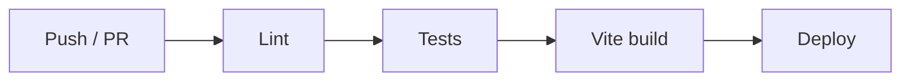

The deploy workflow runs **lint and tests before building**. The simulator is **not a substitute for real devices**: it does not model actual speaker/microphone frequency responses, distortion, or OS audio processing.

---

## 💡 Tips, Limits & Troubleshooting

| Situation | What to do |
|---|---|
| FAST fails in an echoey room or with people talking | Switch to **ROBUST** |
| Nothing is received | Move devices closer, raise volume (without distortion), run **TEST** |
| INAUDIBLE doesn't work | Many speakers/mics don't reproduce 18–19 kHz; run **TEST** on both devices |
| Bluetooth speaker or headset in use | Turn off Bluetooth audio output |
| Audio stops mid-transfer on mobile | Keep the page in the **foreground**; background tabs or screen lock may suspend audio |
| No sound, `AUDIO PAUSED` | Interact with the page / press **START AUDIO** |
| Microphone blocked | Grant mic permission explicitly in browser settings |
| Encrypted frames "not in this session" | Press **NEW SESSION** on the sender and resend |
| Encrypted frames lost before key entered | Frames heard before the key was set are not kept; sender must resend |
| Encryption unavailable | Use **https** or **localhost** |

---

## 👥 Team

This project is a collaborative engineering project developed by:

| S.No. | Name | C.R.N. | U.R.N. | Role |
|:---:|---|:---:|:---:|---|
| 1 | **Akshat Srivastava** | `23/495` | `23EUCIT304` | Core Contributor |
| 2 | **Anuj Raj** | `23/507` | — | Core Contributor |
| 3 | **Sachin Kumar Jha** | `23/111` | — | Core Contributor |
| 4 | **Irfan Khan** | `23/536` | — | Core Contributor |

---

## 🙏 Acknowledgements

SonicBridge builds on the open-source **Chirp** project ([`solst-ice/chirp`](https://github.com/solst-ice/chirp)). Credit to the original author for the modem design and the foundation this work extends.

---

<div align="center">

**Made with 🔊 by Akshat Srivastava, Anuj Raj, Sachin Kumar Jha & Irfan Khan**

</div>
